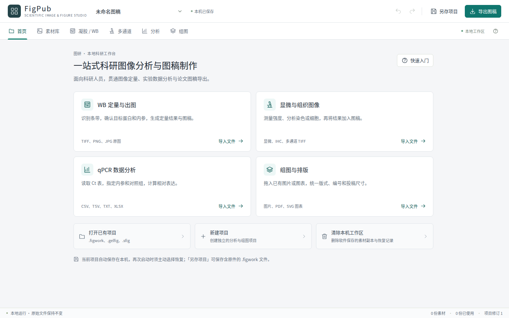
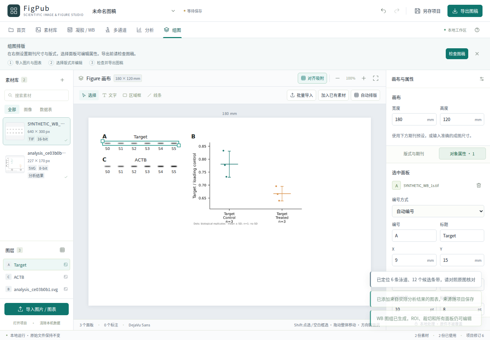
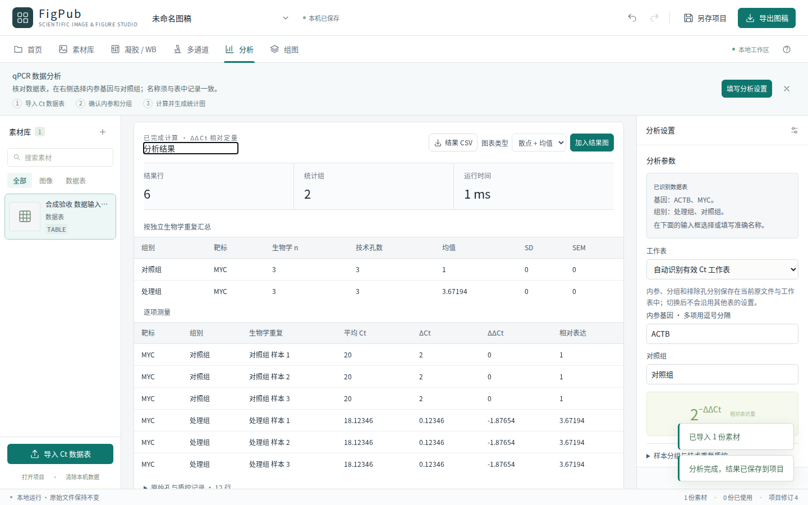
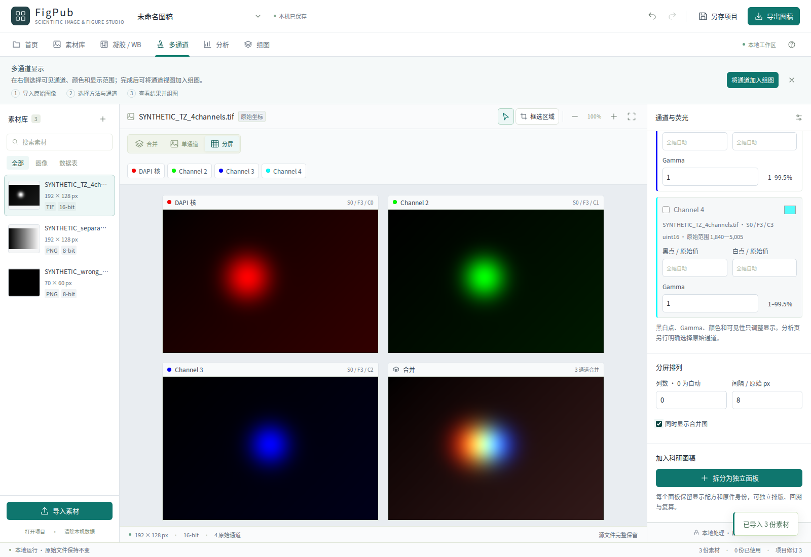
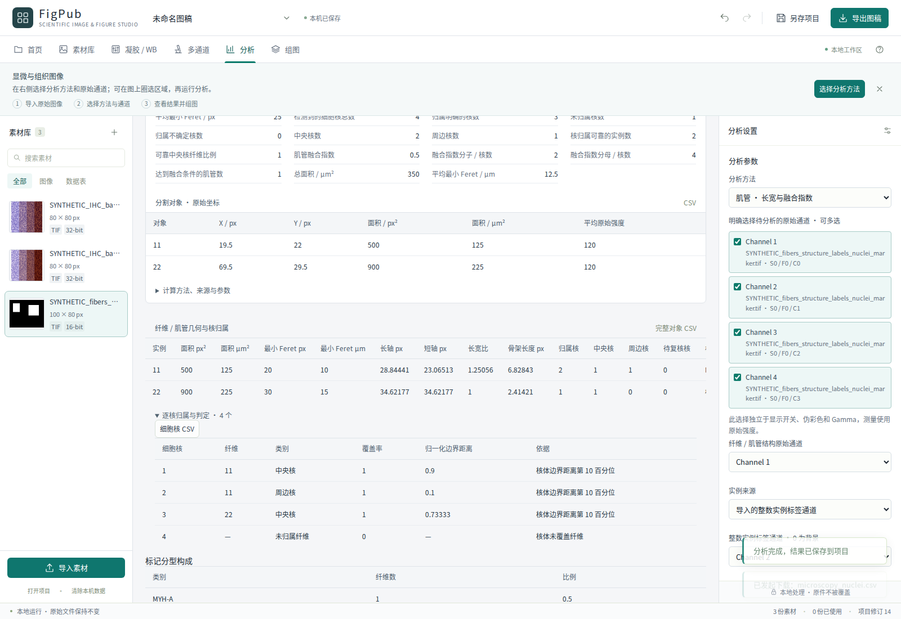
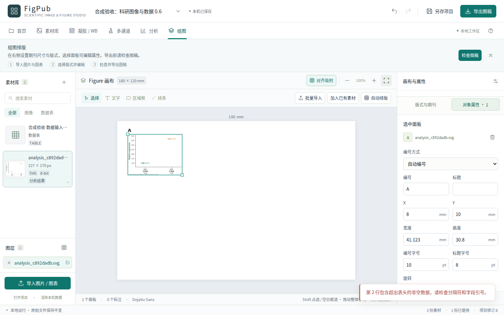

# FigPub

**面向科研人员的一站式图像分析与论文图稿制作平台**

FigPub 将 Western blot 定量、qPCR 分析、多通道显微图像处理、组织图像分析、Cellpose 细胞分割与科研组图整合到统一工作台，连接原始数据、定量结果和可编辑图稿。

[下载 Windows 安装包](https://github.com/aper-ai/FigPub/releases/download/v0.6.2-rc.2/Figure_Workbench_0.6.2_Setup.exe) · [版本说明](https://github.com/aper-ai/FigPub/releases/tag/v0.6.2-rc.2) · [使用手册](docs/USER_GUIDE.md) · [源代码与开发文档](docs/ARCHITECTURE.md)

## 核心功能

| 工作模块 | 主要功能 |
| --- | --- |
| **Western blot** | 条带与泳道定位、可编辑 ROI、背景扣除、目标蛋白及内参配对、归一化定量、统计图与组合面板 |
| **qPCR** | Ct 数据导入、技术重复质控、多内参、ΔCt / ΔΔCt、相对表达量、生物学重复汇总 |
| **多通道显微图像** | 多维 TIFF、T/Z 帧、多通道伪彩、合并及分屏、原始强度测量、通道重叠与线剖面 |
| **Cellpose 与实例复核** | CPU 模型分割、实例轮廓显示、人工拆分/合并/补画、测量结果更新及标签导出 |
| **组织与形态学** | H/DAB 染色分离、染色强度分级、校准、肌管与纤维形态测量 |
| **科研组图** | 期刊尺寸、网格布局、编号自动对齐、拖动吸附参考线、图稿标注、对象编辑与排版 |
| **工程与导出** | 保存分析来源和参数，支持可恢复工程；导出 PDF、SVG、PNG、TIFF、PPTX 等 |

## 软件界面与工作流程

以下展示软件实际操作界面。为便于复现，界面中的分析示例使用合成测试数据；图片展示软件交互效果，不作为生物学实验结果或模型准确率的证明。

<!-- FIGPUB_GALLERY_START -->

### 工作台首页



统一的科研图像和数据任务入口。

### Western blot 定量



条带 ROI、定量结果和可编辑组图。

### qPCR 分析



Ct 数据处理、生物学重复汇总与结果检查。

### 多通道显微图像



通道伪彩、分屏显示与图像处理。

### 组织与纤维分析



组织图像定量及形态学工作流程。

### 实例人工复核


分割实例编辑、测量结果复核与工程恢复。

### 科研组图



图稿画布、对象布局、标注与导出。

<!-- FIGPUB_GALLERY_END -->

## 下载与运行

### Windows 客户端

**[下载 FigPub 0.6.2 RC2（Windows 10/11 x64）](https://github.com/aper-ai/FigPub/releases/download/v0.6.2-rc.2/Figure_Workbench_0.6.2_Setup.exe)**

安装包包含图像分析工作台、科学计算运行环境以及 Cellpose `nuclei`、`cyto3` CPU 模型，无需单独配置 Python。安装完成后，从 Windows 开始菜单打开应用即可导入图片或数据。

当前安装包仍沿用上一名称 **Figure Workbench** 的文件名及程序标识。已发布安装包不会随项目展示名称自动更改；后续新版本将统一采用 FigPub 品牌。0.6.2 RC2 为测试候选版本，原生完整业务流程及包内模型推理仍需完成该版本的最终验收。

使用 `.figwork` 保存可重新编辑的工程；图稿可按需导出为投稿或交流所需格式。Windows 项目工作区与程序安装目录相互独立，升级或卸载不会主动清除工作区内容。

### 从源码运行

建议使用 **Python 3.12（64 位）**，安装依赖后执行：

```bash
python -m pip install -r requirements.txt -r requirements-desktop.txt
python run.py
```

Windows 也可使用 `start_windows.bat` 初始化开发环境。macOS/Linux 可执行 `python3 launch.py` 启动本地服务。源码环境与预打包 Windows 模型运行时不同；需要完整离线模型环境时请使用 Windows 安装版。

### 历史版本

[0.6.1 Windows 完整包](https://github.com/aper-ai/FigPub/releases/download/v0.6.1/Figure_Workbench_0.6.1_Windows_Full.zip) 可作为旧版运行参考；旧版不包含 0.6.2 的组图编号及吸附交互更新。相关版本、变更记录与历史安装包保留在 [Releases](https://github.com/aper-ai/FigPub/releases)。

## 输入、输出与可复核性

软件支持 TIFF、PNG、JPEG 等图像及 CSV、TSV、XLSX 等结构化数据。多维显微图像保留序列、帧和通道身份；图像显示设置与定量所用原始数据分开记录。分析结果关联来源文件、ROI、参数与处理记录，可在工程中复核。

图稿支持 PDF、SVG、PNG、TIFF、PPTX 导出。输出分辨率与原始图像有效 PPI 分别检查；图稿导出不能提升原始数据的有效分辨率。具体格式与限制见 [使用手册](docs/USER_GUIDE.md)。

## 文档与开发

[使用手册](docs/USER_GUIDE.md) · [浏览器组图说明](docs/BROWSER_STUDIO.md) · [架构与数据契约](docs/ARCHITECTURE.md) · [数值与数据质量说明](docs/QA_SCIENCE_0.5.md) · [测试和发行记录](https://github.com/aper-ai/FigPub/actions)

FigPub 由 **Aper AI** 维护，按 [AGPL-3.0](LICENSE) 开源。内置的 Cellpose、第三方计算库与有关数据目录分别遵循其原始许可，详细信息见 [licenses](licenses/) 及 [依赖许可](docs/DEPENDENCY_LICENSE_METADATA.json)。图稿及科研图像的知识产权归各自权利人所有。
