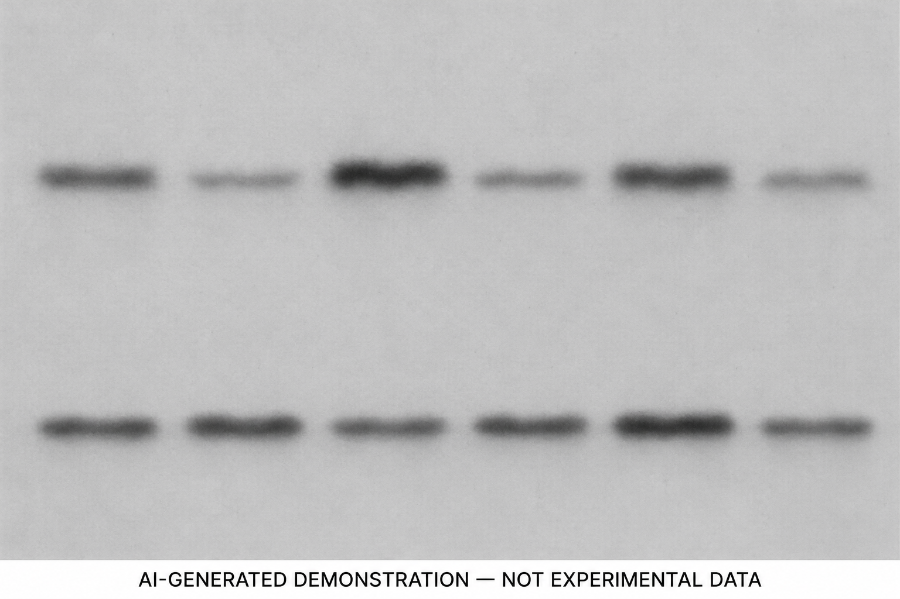

# 图研 · Figure Workbench

**科研图像定量、实验数据分析与论文图稿制作平台**

Figure Workbench 面向生命科学研究，将 Western blot 定量、qPCR 分析、多通道显微图像处理、细胞分割与科研组图整合到同一本地工作环境。项目以原始数据、分析参数和结果来源为核心，支持从数据导入、定量分析、人工复核到图稿导出与工程归档的完整流程。

主维护仓库：[aper-ai/figure-workbench](https://github.com/aper-ai/figure-workbench) · 当前源码：**0.6.2 候选版** · 已发布版本：**0.6.1** · 许可证：[AGPL-3.0](LICENSE)

[主要功能](#主要功能) · [工作流程与演示材料](#工作流程与演示材料) · [下载与运行](#下载与运行) · [输入与输出](#输入与输出) · [验证记录](#验证记录) · [技术文档](#技术文档)

## 0.6.2 工作区与交互更新

0.6.2 候选版将正式客户端与开发资料分开打包。客户端不预装实验图片、案例工程或文档截图；首次启动为空白工作区，已有自动保存须主动选择恢复。新建项目与清除本机副本是独立操作，清理失败会明确保留待重试状态。详情见[工作区与素材隔离说明](docs/WORKSPACE_PRIVACY_0.6.2.md)。

期刊预设、图稿布局和对象属性在参数修改后自动生效，去除重复确认按钮；浏览器组图支持连续输入合并撤销、无效草稿校验，以及保存/导出前提交有效修改。

本候选版尚需对应提交的 Windows 完整包验收。下方 0.6.1 下载链接和历史验证数据不代表候选版已经发布或通过验收。

## 主要功能

| 模块 | 主要能力 |
| --- | --- |
| **凝胶与 Western blot** | 泳道与条带候选定位、Marker 标注、可编辑 ROI、背景扣除、同图及跨图内参配对、多曝光质量复核、归一化定量与统计图生成。 |
| **qPCR 数据分析** | CSV/XLSX 工作表识别、多内参、技术重复质控、逐孔排除、ΔCt/ΔΔCt 与相对表达量计算；按独立生物学重复进行汇总与统计检验。 |
| **多通道显微图像** | TIFF 序列与 T/Z 帧选择、逐通道伪彩和显示范围、合并与分屏、ROI 原始强度测量、背景扣除、线剖面及通道重叠分析。 |
| **Cellpose 实例分割** | Windows 完整包内置 Cellpose CPU 引擎及官方 `nuclei`、`cyto3` 模型；基于指定原始通道推理，支持任务状态追踪与取消。 |
| **IHC 与形态学分析** | H/DAB 染色分离、染色强度分级、校准与伪影排除；纤维及肌管面积、最小 Feret、骨架长度、核归属和融合指数测量。 |
| **实例人工复核** | 分割实例拆分、合并、删除与补画，支持撤销重做、原始强度复算、标签 TIFF/CSV 导出及工程重开后继续编辑。 |
| **科研组图** | 毫米画布、期刊尺寸预设、规则网格与跨行列布局、多选编组、对齐分布、自动编号、比例尺、文字和线条标注。 |
| **图稿检查与工程管理** | 有效 PPI、字体、画布边界及来源引用检查；保存原始文件、分析参数、结果记录和布局，支持完整 `.figwork` 工程归档。 |

图像显示配置与定量输入分别保存；原始文件及位深保持完整。分析结果关联具体来源、通道、ROI 和参数，参数变化后可识别需重新计算的历史结果。

## 工作流程与演示材料

以下介绍各模块的实际工作流程。WB 演示输入从零 AI 生成并明确标注，仅用于文档；客户端不预装这些图像。当前提交的真实软件截图与运行记录由 Windows 验收流程生成，随对应发行的验收附件提供。

### 工作台与任务入口

统一入口提供 WB、显微与组织图像、qPCR、组图四类工作流程。素材管理、分析与画布操作、参数设置分区呈现。


### Western blot 定量与出图

从原始条带图像建立可编辑 ROI，明确目标蛋白、内参与样本身份，完成定量后生成连续条带面板和关联统计图。



上图仅是文档演示输入，由 imagegen 从零生成，未引用用户素材，不作为实验数据、算法准确率或定量结论的证据。实际软件操作截图由 `scripts/capture_privacy_documentation.py` 在独立临时工作区导入此图后生成；候选版验收完成前不把它描述为已完成的运行截图。

### qPCR 分析与结果汇总

保留原始 Ct 数据及样本身份，按技术重复和生物学重复分别处理，输出逐样本结果、质控记录和可加入图稿的统计图。


### 多通道显微图像

逐通道设置名称、伪彩与显示范围，支持合并和分屏。显示配置与用于定量的原始通道选择独立管理。


### Cellpose 与实例复核

Cellpose 使用完整包中的 CPU 环境和预训练权重执行细胞或细胞核分割。分割结果包含实例轮廓、原图来源及所用模型信息。


实例复核工具提供交互式修订，并依据修订标签重新计算相关指标。编辑结果可保存，并在重新打开工程后继续复核。


## 下载与运行

### Windows 完整工具包

[下载 Figure Workbench 0.6.1 Windows 完整包](https://github.com/aper-ai/figure-workbench/releases/download/v0.6.1/Figure_Workbench_0.6.1_Windows_Full.zip) · [0.6.1 发行记录与验收附件](https://github.com/aper-ai/figure-workbench/releases/tag/v0.6.1)

本仓库提供已验收 0.6.1 发行文件的镜像，软件包、源码包与验收附件的 SHA-256 均与原发行一致。源提交与迁移记录见[仓库来源与维护基线](docs/REPOSITORY_PROVENANCE.md)。

1. 完整解压 `Figure_Workbench_0.6.1_Windows_Full.zip`。
2. 运行 `FigureWorkbench.exe`，保留同级的 `runtime/`、`app/`、`cellpose/` 目录。
3. 选择工作流程，导入原始图像或实验数据，设置分析参数并复核结果。
4. 使用“另存项目”生成可继续编辑的 `.figwork`；使用“导出图稿”生成投稿或交流所需文件。

完整包包含独立运行环境、科学计算依赖和两种 Cellpose CPU 模型，无需另行安装 Python 或下载模型。目标平台为 **Windows 10/11 x64**，系统需具备 **WebView2 Runtime**。该版本使用 CPU 推理，无需 NVIDIA 显卡。

当前工作区保存在 `%LOCALAPPDATA%\FigureWorkbench`。跨电脑转移及长期归档使用包含原始文件的 `.figwork` 工程；升级前可通过“另存项目”保存独立备份。

### 浏览器组图版

[下载独立组图 HTML](https://github.com/aper-ai/figure-workbench/releases/download/v0.6.1/Figure_Workbench_0.6.1_Browser.html)，在现代桌面浏览器中本地打开。该版本提供图片导入、排版、工程保存与 PNG/SVG/栅格 PDF 导出；完整科学分析由 Windows 客户端提供。格式互通说明见 [浏览器组图版文档](docs/BROWSER_STUDIO.md)。

### 源码运行

使用 **Python 3.12 64 位**。Windows 下可运行 `start_windows.bat` 创建环境并安装固定依赖，或在已创建的虚拟环境中执行：

```bash
python -m pip install -r requirements.txt -r requirements-desktop.txt
python run.py
```

首次安装依赖需要联网。源码运行环境不包含发行包附带的 Cellpose 独立环境和模型权重；模型分析可直接使用 Windows 完整包。macOS/Linux 通过 `python3 launch.py` 启动本地服务与浏览器界面。

**Windows 构建资料：**完整工具包的构建流程使用经过 SHA-256 校验的 v0.4.0 基础运行时，单独保存在 [build-runtime-0.4.0](https://github.com/aper-ai/figure-workbench/releases/tag/build-runtime-0.4.0)。该附件用于构建；普通使用下载上方的 0.6.1 完整包。构建来源与校验约定见[仓库来源说明](docs/REPOSITORY_PROVENANCE.md)。

## 输入与输出

| 类型 | 支持内容 |
| --- | --- |
| 图像输入 | TIFF、PNG、JPEG 等常见格式；多维 TIFF 支持序列、T/Z 帧及通道选择；保留原始位深和来源信息。 |
| 图表输入 | PDF、受支持的 SVG；复杂效果的兼容范围见技术文档。 |
| 数据输入 | CSV、TSV、结构化 TXT、XLSX；支持工作表选择及部分仪器表头识别。 |
| 分析结果 | CSV、分割标签 TIFF，以及附带参数与来源信息的分析记录。 |
| 图稿输出 | PDF、SVG、PNG、TIFF、PPTX。PDF/SVG 支持字体嵌入或文字转轮廓；PPTX 保留支持的独立对象。 |
| 工程与归档 | `.figwork` 保存原始文件、布局、ROI、参数、结果与校验清单；支持原始资料 ZIP 导出。 |

PNG/TIFF 图稿输出为显示用 RGB 成图，原始实验数据保存在来源文件与工程中。输出 DPI 与原图有效 PPI 分别检查；PPTX 字体按名称引用。完整格式与操作约定见 [使用手册](docs/USER_GUIDE.md)。

## 验证记录

0.6.1 对应验收提交为 `ea31f2de229d66da8d7fa331caa1f644d7027de6`。下表为该发行版本的实际结果；后续文档或代码提交应分别确认其对应验收状态。

| 验证层次 | 0.6.1 结果 |
| --- | --- |
| Python 数值、接口与持久化 | 732 项通过 |
| 前端逻辑与代码检查 | 265 项通过，lint 通过 |
| 真实浏览器工作流 | 11 套、84 个场景通过 |
| 原生 Windows 客户端 | 15 个场景通过 |
| 完整包内模型推理 | `nuclei`、`cyto3` 均通过 |

验收包括最终 ZIP 解压、中文与空格路径、系统文件对话框、输入输出校验、保存失败恢复、工程重开、窗口退出及后台清理。原始报告、日志、截图及文件 SHA-256 随 [0.6.1 发行记录](https://github.com/aper-ai/figure-workbench/releases/tag/v0.6.1) 提供；[原始 Windows 验收运行](https://github.com/tuantuan007/figure-workbench/actions/runs/43452637043)可核对执行过程。

原生验收环境为 Windows Server 2025。数值与流程回归主要使用已知预期值的合成数据；真实实验图像的条带候选、分割结果、染色分级及样本配对仍需结合原始数据复核。IHC 面积加权指数采用 `pixel_weighted_score`，物理测量依赖有效的像素标定。当前版本提供 CPU 模型，不包含专用纤维训练权重、自动图像配准或 FCS 流式门控。

## 技术文档

| 文档 | 内容 |
| --- | --- |
| [工作区与素材隔离](docs/WORKSPACE_PRIVACY_0.6.2.md) | 空白启动、主动恢复、软件副本清除与打包边界 |
| [使用手册](docs/USER_GUIDE.md) | 工作流程、参数、输入输出格式及工程管理 |
| [架构说明](docs/ARCHITECTURE.md) · [数据契约](docs/CONTRACT.md) | 数据模型、坐标单位、来源与任务管理 |
| [WB 工作流程](docs/WB_0.3.md) | ROI、样本身份、内参配对与曝光复核 |
| [组织与纤维分析](docs/HISTOLOGY_FIBERS_0.3.md) · [实例复核](docs/INSTANCE_REVIEW_0.3.md) | 分析口径、校准、标签编辑与结果导出 |
| [完整包验收](docs/ACCEPTANCE_0.6.md) · [0.6.1 交互修复](docs/QA_INTERACTION_0.6.1.md) | 验收范围、发布要求与任务生命周期修复 |
| [数据输入输出检查](docs/QA_DATA_FLOW_0.6.md) · [科学计算说明](docs/QA_SCIENCE_0.5.md) | 数值精度、异常恢复、统计与科学适用范围 |

## 许可与来源

本项目由 **aper-ai** 维护，按 [AGPL-3.0](LICENSE) 提供。数据、计算、任务、渲染与交互层参考 GelFigure 和 ScieFig 的功能与工程设计重新实现，固定参考版本及实现范围见 [上游对照](docs/UPSTREAM_COMPARISON.md)。

`web/data/ladders.json` 中的 Marker 规格目录及资料链接沿用 GelFigure 目录数据，保留 [MIT 归属](licenses/GelFigure-MIT.txt)。Cellpose、科学计算基础库与字体遵循各自许可证，相关说明见 [licenses](licenses/) 和 [依赖许可记录](docs/DEPENDENCY_LICENSE_METADATA.json)。原始实验图像与数据的权利归其提供者所有。
